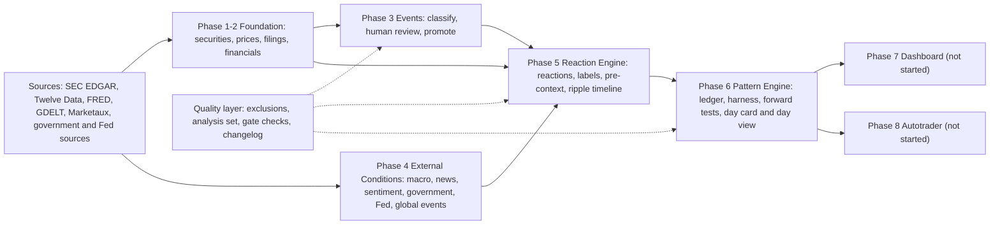

# PROJECT PLAN (v2, 2026-10-28)

**What this file is.** The plan: the goal, the thesis, how evidence is judged, the architecture, the eight phases and what is deliberately not built. It states intent and design only. **It holds no status and no volatile numbers**: where things stand is in README.md (the snapshot) and docs/PROJECT_STATUS.md (the state, the tests, the to-do); names, phase definitions and their "done when" checks are in docs/NAMING.md. The plan's earlier corrections and addenda (2026-09-08 to 2026-09-30) are in CHANGELOG.md at their true dates under the label PROJECT_PLAN; the unedited previous version is docs/archive/PROJECT_PLAN_pre_rewrite_2026-10-28.md.

---

## 1. Project goal

A historical market research platform connecting company financials, corporate events, news, macroeconomic and government conditions, and stock-price reactions, allowing calibrated investigation of how markets have historically reacted to similar events.

```
Company → Financials → Events → External Conditions → Price Reaction → Pattern → Forward tests
```

**The stance, still enforced.** The platform is explicitly *not* trying to predict outcomes. It surfaces historical probabilities with visible sample sizes ("in N comparable cases, X% moved this direction") rather than forecasts. Avoiding overclaiming is a standing principle, and it applies to the platform's own earlier results as much as to the data.

---

## 2. Core philosophy: mechanical patterns versus behavioral patterns

This distinction is the project's actual thesis, and it is worth stating explicitly rather than leaving implicit.

**Mechanical patterns drift.** The specific relationship between a given event type and a given price reaction ("Fed raises rates 75bp → bank stocks move X%") depends on market structure, regulatory regime, competitive dynamics, and macro conditions that change over time. A relationship that held in 2006 may not hold the same way in 2026, because the underlying mechanics (how banks are regulated, how rate-sensitive their balance sheets are, who the marginal buyer of bank stock is) have shifted. This is why event-level pattern claims require the n=30 to 50 threshold, explicit regime-awareness, and calibrated confidence rather than blind trust in historical averages.

**Behavioral patterns are stickier.** Human responses to surprise, fear, herding, overreaction, and narrative-driven decision-making recur across eras with very different market mechanics. Panic-selling on unexpected bad news, herding into already-rising assets, short-term overreaction followed by partial correction, and treating a familiar-sounding narrative ("this is just like 2008") as more informative than it actually is: these are documented behavioral tendencies that show up again and again, specifically because they are about people and cognition rather than the mechanical structure of any particular market era.

**This is what the tag system is for.** The reaction-character tags (rewarded, punished, muted, and the derived diverged_from_fundamentals) and the broader tag governance discipline (cap about 20 to 30 tags in total, require 2 to 3 real instances before creating a new one) exist to capture the behavioral layer of market reactions, separate from the mechanical causal-attribution layer. A causal-attribution tag says "this event caused this outcome, with this confidence." A reaction-character tag says "the market's psychological response to this class of surprise was X": a claim about human behavior, not market mechanics.

**The practical implication for Phase 8, and for the project generally:** mechanical event-to-price relationships need continuous revalidation as regimes shift. They are useful today, and their usefulness must be re-earned, not assumed permanent. Behavioral reaction patterns are the sturdier long-term bet, because the "market" is ultimately made of people, and people's cognitive tendencies under uncertainty are far more stable across decades than any specific market's plumbing. A genuinely reliable eventual "brain" leans more heavily on the behavioral substrate than on any single mechanical relationship, and treats every mechanical pattern as provisional until re-confirmed against current conditions.

**What the evidence says so far (2026-10-28).** The thesis is the reason the questions are asked; it is not a finding. Against a proper null no reaction tag has survived testing, the label is a low-contrast filter for a single 20-day horizon, and the diverged tag's definition is unstable (docs/PROJECT_STATUS.md section 3.5). Nothing here weakens the plan: it is exactly the situation Section 3 exists to catch.

---

## 3. How evidence is judged

### 3.1 The prediction contract
The n=30 to 50 rule protects against calling a small sample a pattern. It does not protect against discovering a pattern and testing it on the same data it was discovered in, and those are different failure modes. **No finding may be called a pattern unless it declares all of the following:**
- **Universe**: which companies and sectors it is drawn from, and whether that universe is broad enough to generalize.
- **Horizon**: day 0, 0 to 1, 0 to 5, 0 to 20, and so on, not one unspecified "reaction".
- **Benchmark**: abnormal return against SPY and against a sector or peer basket.
- **Base rate**: what fraction of random, unrelated same-sector days show the same move.
- **Similarity keys**: event type alone is not sufficient; surprise sign and size, firm state, regime, and size or liquidity must be specified. Firm state is point-in-time only from about 2010, and any key states which availability rule it uses. The size bucket now stored in event_pre_context is a single constant value and carries no information, so size needs a real source. Surprise sign remains the one genuinely unbuilt key: it needs analyst consensus estimates, which no part of the project ingests.
- **Magnitude and dispersion**: mean and median abnormal return with a confidence interval, never a bare directional percentage.
- **Out-of-sample window**: see the walk-forward rule below.
- **Sample size, stated twice**: rows and independent clusters (a company's events within 28 calendar days count as one cluster), because overlapping 20-day windows are not independent observations. The n rule applies to clusters.

### 3.2 The walk-forward evaluation harness
Mandatory before any tag reaches "real pattern" status:
- Tag definitions are fit or discovered only on data through date T.
- The tag is scored only on events after T, with overlapping 20-day windows purged between the fit and the scoring periods.
- The tag definition is never re-tuned on the evaluation window.
- Every candidate pattern is compared against at least two dumb baselines: the firm's unconditional drift, and random events of the same broad type.

Phase 6's real deliverable is not a dashboard-ready statistic. It is an evaluation capability that can say "this tag is not ready (n=11, interval crosses 50%, fails against the sector baseline)" as readily as it reports a positive finding. A dashboard on top of that is Phase 7. D1 and D2 (including the base rate) are built; D3 (the tag-level walk-forward split) and D4 (the similarity-key hierarchy) are the unbuilt deliverables.

### 3.3 The machinery that enforces it
- **The flag ledger:** every claim is a row with a status (proven, lead, null, untested, retired) and its evidence.
- **Pre-registration:** a test is registered before it runs, with predictions that carry a range and an anchor (DATA, LITERATURE or NONE), and scored afterwards.
- **Frozen forward tests:** the forward tests are frozen until both verdicts are recorded, enforced by a git hook.
- **Sealed companies:** a seeded 30% of companies is held out of all exploration.
- **The analysis set and the exclusions table:** statistics read one view that removes events with a recorded `exclude` reason, so a data limit is applied everywhere or nowhere.
- **Checks instead of percentages:** each phase is done when a query says so (docs/NAMING.md).

---

## 4. Architecture



Everything flows through one principle: **each phase exists to make the next trustworthy.** Skipping ahead, building a flashier phase on an unreliable earlier one, only automates unreliability faster.

---

## 5. The eight phases

Each phase answers one question; its definition and its "done when" check are in docs/NAMING.md, and its current state is in docs/PROJECT_STATUS.md.

| # | phase | why it exists | depends on |
|---|---|---|---|
| 1 | Data Foundation | Is the raw data correct and complete? Prices, filings, financials, onboarding | external sources |
| 2 | Financial Analysis | Given correct raw data, what do the financials mean? Metrics, condition score, null register | 1 |
| 3 | Corporate Events | What happened, and can we prove it? The evidentiary backbone: classify, review, promote | 1 |
| 4 | **External Conditions** | What was the world telling the market? Tracks: macro (FRED), news and sentiment (GDELT, Marketaux), government decisions (laws, orders, tags), the Federal Reserve (FOMC calendar), global events | 1 |
| 5 | Price Reaction Engine | How did the market respond, net of what the whole market did? Reactions, labels, pre-context, ripple timeline | 1, 3, 4 |
| 6 | Historical Pattern Engine | Does this actually recur, or does it only look like it does? Tracks: evaluation harness, flag ledger and event premium, ranges and bands, decomposition, day card and day view | 5 |
| 7 | Dashboard / Website | Can a person see and use it? | 6 |
| 8 | Autotrader | Can the system act on its own analysis, safely? | 1 to 7 |

Phase 4 was named "News Ingestion" until 2026-10-28; the name was too narrow for what it holds.

### Phase 8 design (to be scoped in its own planning pass)
The long-term destination is a "brain that needs memories": the platform's output driving automated decisions. It is explicitly not started, and gated on the earlier phases being genuinely, not approximately, trustworthy. When scoped it needs a historical replay and backtesting environment built on the principle of repeating and tweaking until it improves, adapted correctly for markets. **There is no physics-engine equivalent to generate synthetic training data, and training a bot against a fake simulator only teaches it to beat its own assumptions.** The environment must replay REAL history, controlling only what information the bot may see at each point in simulated time. Required components:
1. **A forward-moving clock** that steps through real history and lets the bot query only data timestamped strictly before the simulated "now" (the same look-ahead discipline as the point-in-time rules in Section 3.1).
2. **A concrete, scoreable decision per step**, for example calibrated odds on a pending event's eventual reaction, scored once the real outcome would have arrived.
3. **A real scoreboard**: calibration and hit-rate metrics computed identically every run, with a held-out slice never touched during tuning.
4. **A "speed run of a week" framing**: hide a target week's real data, run using only prior-knowable information, compare with the real result, and repeat across many historical weeks.

Honest scoping caveat: coverage is event-driven, not continuous, so many weeks have no eligible events for any given company. "Hundreds of runs" means sampling across the whole history, not hundreds of distinct information-rich weeks. Also required: backtesting on genuinely held-out data, a mandatory paper-trading stage, risk management and position sizing as a separate system from the forecasting engine, a tested kill switch, real broker integration with its own failure modes, and regulatory review appropriate to scale. Dependencies: a point-in-time descriptive context layer as the feature set, and the still-missing surprise-versus-consensus data.

---

## 6. Universe and coverage

The universe is the current index membership (today's members only, a survivorship limit), with sectors assigned from the GICS constituent list. A seeded 30% of companies is sealed for exploration. The original plan's tiered rollout from a small set of anchor companies was retired when the universe grew to the full index; its text is in the archived original. Delisted and predecessor-ticker coverage is an open data gap (Section 7).

---

## 7. What is deliberately not built, and open design decisions

- **Live scoring.** Scheduled ingestion exists (nightly classification, daily news), but nothing scores live events against the pattern engine, and live automation is gated on a tag surviving the walk-forward harness and a costed expected-value test.
- **Public-opinion sentiment as a signal.** The company sentiment series is built; using it as a signal is untested and subject to the same n discipline.
- **The full multi-factor attribution model.** Factors 1 to 3 exist in the decomposition; factors 4 and 5 stay unbuilt until a registered test shows factors 1 to 3 add beyond a company's own volatility.
- **News-sequence chain detection.** Well specified but deferred: detecting when a sequence of articles over time (report, follow-up, resolution) forms a real event chain.
- **`surprise_vs_consensus`.** The one missing similarity key; it needs analyst estimates, a new data source. It is a real, flagged gap, not silently omitted or faked with a weaker proxy.
- **Delisted and survivorship-free data, and a mid and small cap pilot.** Both need paid data.
- **The firm-state definition.** Any firm-state key or tag waits for a point-in-time definition with a stated availability rule (docs/PROJECT_STATUS.md, gate G6).
- **Phase 7 and Phase 8** are not started, by design.

---

## Appendix: news category taxonomy (reference)

**Macroeconomic and monetary policy news:** interest rates, inflation reports, employment data, GDP growth.
**Corporate and industry news:** earnings reports, mergers and acquisitions, regulatory changes, leadership and operations (CEO changes, layoffs, recalls).
**Global and unexpected events:** geopolitical tensions, natural disasters, systemic shocks (pandemics, banking crises, commodity supply blockades).

---

*v2, 2026-10-28. A change to this plan is a dated entry in CHANGELOG.md; this file keeps only the current design.*
